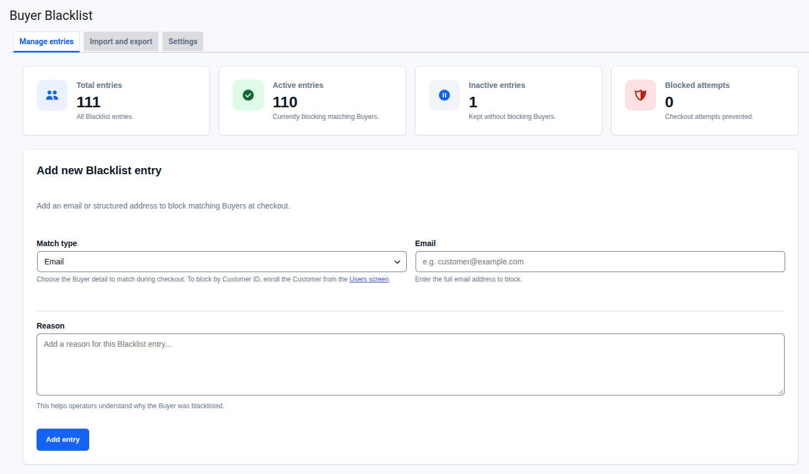
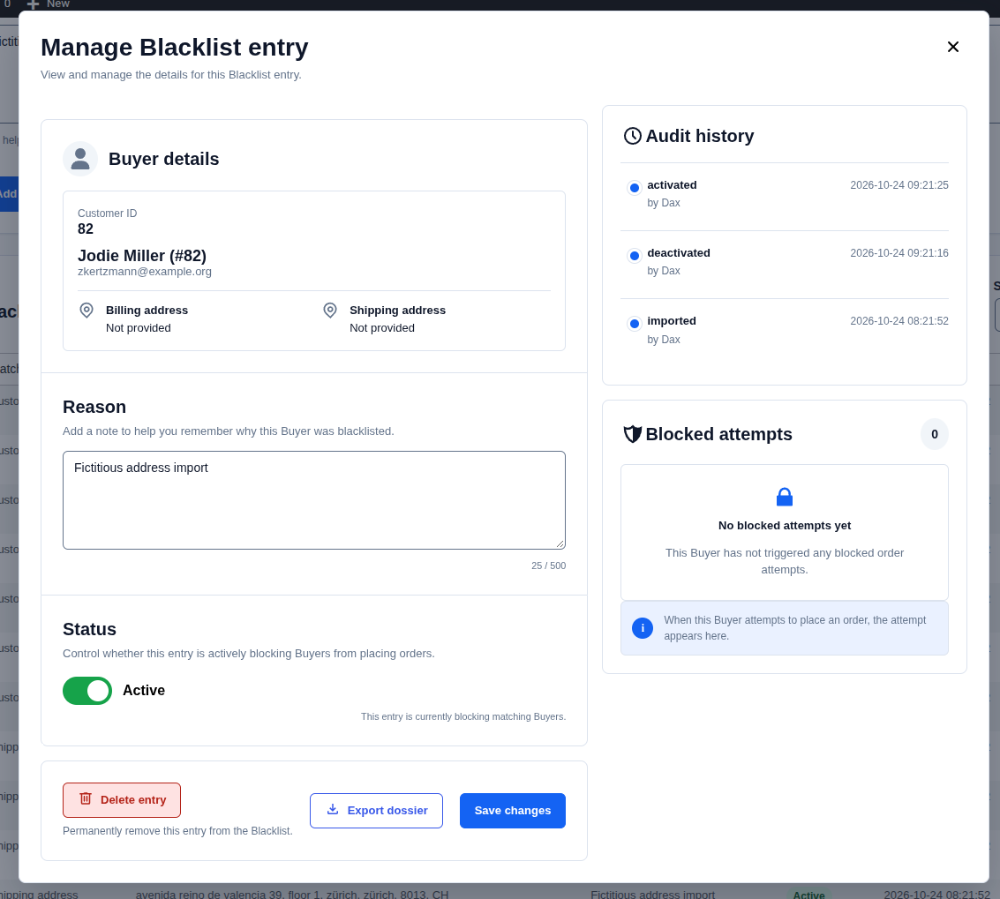
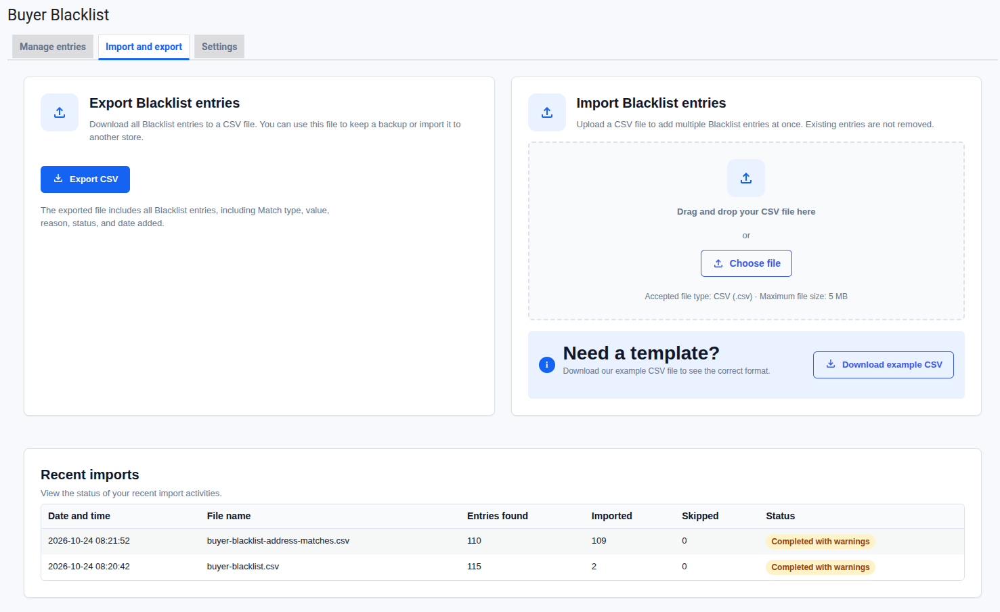
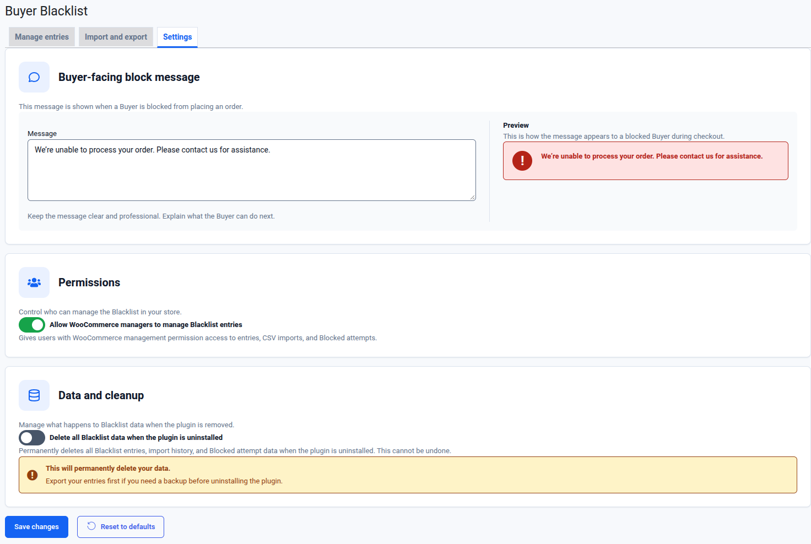
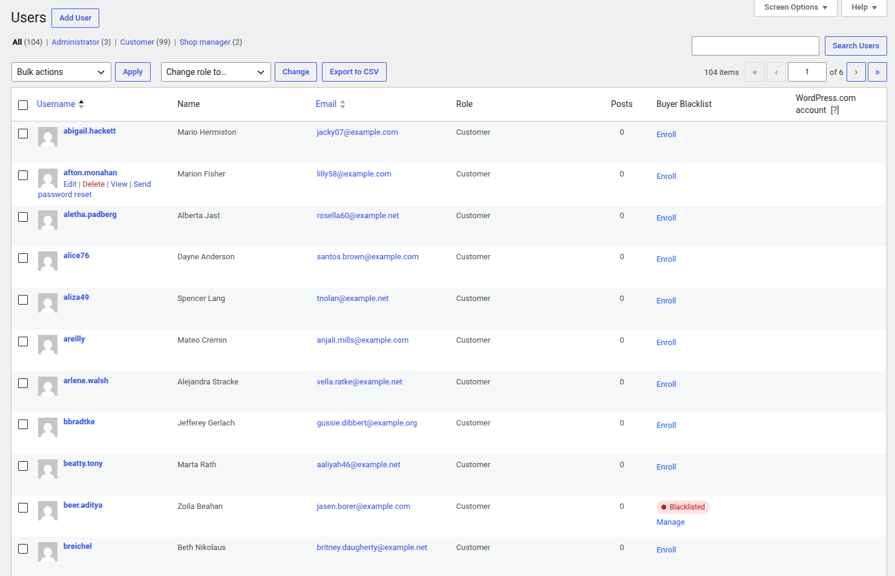

# WP Buyer Blacklist

WP Buyer Blacklist stops listed Buyers from completing checkout in a WooCommerce store. You keep a list of Blacklist entries. Each entry names one Buyer identity: an email address, a WooCommerce Customer ID, a billing address or a shipping address. When an active entry matches the Buyer at checkout, the order is refused before payment.

The list belongs to one store and you fill it by hand. The plugin does not score orders for fraud, share a list with other stores, or ban WordPress user accounts. A blocked Buyer can still log in, browse and use the cart.

The terms used here (Buyer, Blacklist entry, Match type, Canonical value, Blocked attempt, Audit event) are defined in [CONTEXT.md](CONTEXT.md).

## Screenshots

**Manage entries.** See the totals at a glance and add an entry. Below the form, a table lets you search, filter and open every entry.



**Entry dialog.** Edit the reason, switch an entry on or off, and see its Audit history, Blocked attempts and current Buyer.



**Import and export.** Check a CSV file before anything is created, then confirm the import.



**Settings.** Set the message a blocked Buyer sees, who can use the plugin, and what happens on uninstall.



**Users screen.** Enroll a Customer and see which Customers are blacklisted.



## Requirements

- WordPress 6.9 or later
- WooCommerce 10.8 or later, with High-Performance Order Storage (HPOS)
- PHP 8.3 or later

WordPress won't activate the plugin until WooCommerce is active. If WooCommerce is deactivated later, Administrators see a notice saying Blacklist operations are unavailable, and the plugin does nothing else until WooCommerce is active again. Your entries stay in the database.

## Installation

### From a ZIP file

1. Download `wp-buyer-blacklist-<version>.zip` from the [latest release](https://github.com/dcaste/wp-buyer-blacklist/releases/latest). Use that file, not the **Source code** archives GitHub adds to every release. Those hold development files and unpack into a differently named folder.
2. In WordPress, go to **Plugins > Add New > Upload Plugin**.
3. Choose the ZIP and select **Install Now**.
4. Select **Activate Plugin**.

WordPress does not announce new versions of a plugin installed this way. To update, download the newer ZIP and upload it the same way. WordPress asks whether to replace the installed version, and your entries stay in the database.

### From source

Clone the repository into `wp-content/plugins/wp-buyer-blacklist` and activate it on the **Plugins** screen.

The built admin app in `build/` is committed, so a fresh clone works without a build step. If you change anything under `assets/admin/`, rebuild it:

```sh
npm install
npm run build
```

`composer install` is not needed to run the plugin. The main plugin file registers its own autoloader for the classes in `src/`, and the plugin has no runtime Composer dependencies. You only need Composer for the development checks below.

The plugin creates its database tables when it is activated, and checks them again on every load.

## Getting started

This walkthrough blocks a test email and finds the record of the blocked checkout.

1. Go to **WooCommerce > Buyer Blacklist**. The **Manage entries** tab opens.
2. In **Add new Blacklist entry**, leave **Match type** set to **Email**, enter a test address such as `blocked@example.test`, and add a reason. Select **Add entry**.
3. The entry appears in the **Blacklist entries** table as **Active**.
4. In a private browser window, add a product to the cart and go to checkout. Use `blocked@example.test` as the billing email and place the order.
5. Checkout stops with the message "We're unable to process your order. Please contact us for assistance." No order is created and no payment is taken.
6. Back on **Manage entries**, the **Blocked attempts** card at the top counts it. Select **Manage** on the entry to open **Manage Blacklist entry**. The **Blocked attempts** panel lists the date and time of the attempt.

To let the test Buyer through again, open **Manage** and switch **Status** to **Inactive**.

## Using the plugin

The plugin page is **WooCommerce > Buyer Blacklist**. It has three tabs: **Manage entries**, **Import and export** and **Settings**. Only Administrators see **Settings**.

### Manage entries

The top of the tab shows four totals: **Total entries**, **Active entries**, **Inactive entries** and **Blocked attempts**.

**Add new Blacklist entry.** Choose a **Match type**: **Email**, **Billing address** or **Shipping address**. An email needs the full address. An address needs **Address line 1**, **City**, **State**, **Postcode** and a two-letter **Country** code such as `US`. **Address line 2** is optional. **Reason** is required. It is a note for other operators. Select **Add entry**.

Manual entry has no Customer ID option. See [Rules to be aware of](#rules-to-be-aware-of).

**Blacklist entries table.** It shows 20 entries per page, newest first. Search by value or reason, filter by **Match type** and **Status**, and select **Reset** to clear the filters. Select the **Updated** heading to reverse the order.

**Manage Blacklist entry.** Select **Manage** on a row to open the entry. From there you can:

- see the **Buyer details**. When the entry points to one registered Customer, the dialog shows their name, email and addresses.
- edit the **Reason** (up to 500 characters) and select **Save changes**.
- switch **Status** between **Active** and **Inactive**. The change applies straight away.
- read the **Audit history**: who created, imported, changed, activated or deactivated the entry, and when.
- read the **Blocked attempts** for this entry.
- **Delete entry**, after a confirmation. Administrators only.
- **Export dossier** as a JSON file. Administrators only.

### Enrolling Buyers from WooCommerce data

You can create entries from data WooCommerce already holds, so you don't retype an email or address. These flows also offer the **Customer ID** Match type. Each one asks for a Match type and a reason, and the reason is required. A Match type the source has no usable value for is unavailable or skipped. The plugin never creates a partial entry.

The new entry is a snapshot. It keeps the value it had when you created it, even if the Customer or Order changes or is deleted later.

**Users screen (Customers).** On **Users**, a **Buyer Blacklist** column appears for users with the Customer role.

- A Customer with no entry shows **Enroll**. It opens **Enroll Buyer in Blacklist**, which shows the Buyer's current name, user ID, email and addresses. Pick a **Match type**, add a **Reason**, then select **Create entry**.
- A Customer with an entry shows **Blacklisted** or **Inactive** and a **Manage** link. **Manage** lets you pick the matching entry, edit its reason (**Save reason**) and activate or deactivate it.
- To enroll several Customers at once, select them, choose **Enroll in Blacklist** from **Bulk actions**, and select **Apply**.
- A Customer's profile page has a **Buyer Blacklist** row with an **Enroll in Blacklist** link.

**Orders screen.** **Enroll in Blacklist** is available as a row action on **WooCommerce > Orders**, in **Bulk actions**, and in the **Order actions** menu on a single order.

The bulk flows and the order flows open the **Enroll in Blacklist** page. Choose a **Match type**, enter a **Reason**, and select **Create entries**. The result shows how many entries were created, how many were skipped as duplicates, and how many were skipped because the source had no usable value. Every new entry gets the same reason.

### Import and export

**Import Blacklist entries.** Drop a CSV file on the import card or select **Choose file**. The file must be a UTF-8, comma-separated `.csv` with a header row, no larger than 5 MB. Select **Download example CSV** to get a file in the right format.

The columns are:

```text
match_type,email,customer_id,address_line_1,address_line_2,city,state,postcode,country,reason,status
```

- `match_type` is required on every row: `email`, `customer_id`, `billing_address` or `shipping_address`.
- An `email` row needs `email`. A `customer_id` row needs the ID of an existing Customer. An address row needs `address_line_1`, `city`, `state`, `postcode` and `country`. `address_line_2` is optional.
- A blank `reason` becomes `Imported blacklist entry`.
- A blank `status` becomes `active`. The other allowed value is `inactive`.
- Column order doesn't matter, and the importer ignores unknown columns. Files with a byte-order mark or CRLF line endings are accepted, and blank rows are skipped.

The importer checks the whole file before it creates anything. **Import review** shows how many rows are valid, duplicate and rejected, with the row number and reason for each one it will skip. Nothing is created until you select **Confirm import**. Rows that match an existing entry are skipped as duplicates, and so is a repeated row within the same file. Existing entries are never changed or removed.

**Recent imports** lists past imports with the file name, entries found, entries imported, duplicates skipped and the outcome. There is no undo.

**Export Blacklist entries.** Administrators can select **Export CSV** to download every entry, active and inactive. The file uses the same columns as the import, so you can import it into another store.

### Settings

Only Administrators can open this tab.

- **Buyer-facing block message.** The text a blocked Buyer sees. Plain text only. **Preview** shows it as it will appear. If you save it empty, the default message comes back.
- **Permissions.** **Allow WooCommerce managers to manage Blacklist entries** is on by default. When it is on, users who can manage WooCommerce (usually Shop Managers) become Blacklist operators. When it is off, only Administrators can use the plugin.
- **Data and cleanup.** **Delete all Blacklist data when the plugin is uninstalled** is off by default. See [Rules to be aware of](#rules-to-be-aware-of).

Select **Save changes** to save. **Reset to defaults** asks for confirmation, then restores all three settings to their defaults.

## Rules to be aware of

**Entries can't be edited in place.** You can't change an entry's Match type or value after creating it. To replace one, deactivate the old entry and create a new one. The reason and the status can always change, but a reason can't be saved empty. Entries created before the reason became required can keep an empty reason until someone edits it.

**No duplicates.** The plugin refuses a second entry with the same Match type and Canonical value, even if the existing entry is inactive. Reactivate the existing entry instead.

**Email matching is literal.** Emails are compared after trimming surrounding spaces and ignoring case. Nothing else is normalized. `Buyer@Example.com` matches `buyer@example.com`, but `buyer+shop@example.com` and Gmail dot variants such as `b.uyer@gmail.com` are different identities.

**Address matching needs a complete address.** An address matches only when address line 1, city, state, postcode and country are all present at checkout. Fields are compared after trimming, collapsing repeated spaces and ignoring case. Address line 2 counts too, so `Apt 4` against an empty line 2 is not a match. The plugin does not treat abbreviations, accents or postcode formats as equal. `Main St` and `Main Street` are different addresses.

**Customer ID comes from existing Customers.** The manual entry form does not offer Customer ID. Create those entries from the Users or Orders screens, or by CSV import with the ID of an existing Customer. A Customer ID entry only matches a Buyer who checks out logged in to that account. If the same person checks out as a guest, only an email or address entry will catch them.

**Every identity at checkout is checked.** The plugin checks the billing email, the logged-in Customer ID, the billing address and the shipping address. Any active match blocks the order. An inactive entry never blocks.

**Only storefront checkout is blocked.** The plugin blocks classic checkout, the Checkout block, Store API checkout, and Agentic Commerce checkout when your WooCommerce version provides it. It does not block:

- orders that staff create or edit in wp-admin,
- subscription renewals,
- orders created through the authenticated WooCommerce REST API,
- any other way of creating an order.

WooCommerce may still create a draft order during checkout. The plugin stops the checkout before payment and before a final order exists.

**The Buyer learns nothing about the match.** Every blocked Buyer sees the same message. It never shows the Match type, the matched value or the reason.

**Every blocked checkout is recorded.** Each time a request is blocked, the plugin records one Blocked attempt per matching entry. It records retries too. It sends no email or other notification.

**Deleting and deactivating are different.** Deactivating an entry stops it from blocking and keeps its reason, Audit history and Blocked attempts. Deleting it removes the entry, its Audit history and its Blocked attempts. Only a dated record that a deletion happened remains, with no user or identity.

**Deleting a Customer keeps their entries.** When WooCommerce or WordPress deletes a Customer, their Blacklist entries stay and keep blocking.

**Deactivating the plugin keeps your data.** Uninstalling removes entries, Audit events, Blocked attempts, import history and plugin settings only if **Delete all Blacklist data when the plugin is uninstalled** was on before you deleted the plugin. Otherwise the data stays in the database.

**Operators and Administrators can do different things.** A Blacklist operator is an Administrator, or a WooCommerce manager when **Allow WooCommerce managers to manage Blacklist entries** is on. Operators can:

- add entries and enroll Buyers from the Users and Orders screens,
- edit reasons and activate or deactivate entries,
- import CSV files,
- see Audit history and Blocked attempts.

Only an Administrator can:

- open **Settings**, including the Buyer-facing block message,
- delete entries,
- export the full list as CSV,
- export an identity dossier,
- export or erase data through the WordPress privacy tools.

**What the plugin stores.** For each entry it stores the value, reason, status and dates. Audit events store the action, the time, and the acting user's ID and display name, but not their email. A Blocked attempt stores the time, the matched value and the entry it matched. The plugin does not store cart contents, payment data or IP addresses.

## Privacy

The plugin registers with the WordPress personal-data tools under **Tools > Export Personal Data** and **Tools > Erase Personal Data**. Both look up Email entries by the email address in the request. An export includes the entry, its reason and its Blocked attempts. An erasure removes the entry and its Blocked attempts and keeps only a dated, non-personal record that an erasure happened.

The WordPress tools can't find Customer ID or address entries. For those, use **Export dossier** and **Delete entry** in **Manage Blacklist entry**. An identity dossier is a JSON file with the entry, its Audit events and its Blocked attempts.

## Development

The product requirements are in [docs/prd/product.md](docs/prd/product.md), and architecture decisions are in [docs/adr/](docs/adr/). Branching rules are in [docs/engineering/git-workflow.md](docs/engineering/git-workflow.md). To contribute, read [CONTRIBUTING.md](CONTRIBUTING.md). To report a vulnerability, read [SECURITY.md](SECURITY.md).

Install the tools and run the checks:

```sh
composer install
npm install
composer lint
composer test
npm test
npm run build
```

`composer lint` runs PHP_CodeSniffer with [WordPress-Extra](https://github.com/WordPress/WordPress-Coding-Standards). `composer lint:fix` applies its automatic fixes. `npm run build` compiles the admin app from `assets/admin/` into `build/`. Commit the rebuilt files with your change.

### Integration tests

`composer test:integration` runs the tests in `tests/integration` against real WordPress and WooCommerce. It needs:

- a MySQL database the tests can wipe,
- the WordPress test library, installed with `bin/install-wp-tests.sh`,
- a WooCommerce checkout on disk.

Install the test library once:

```sh
bin/install-wp-tests.sh <db-name> <db-user> <db-pass> [db-host] [wp-version]
```

The script installs to `$WP_TESTS_DIR`, which defaults to `/tmp/wordpress-tests-lib`. Then run:

```sh
composer test:integration
```

`WC_PLUGIN_DIR` defaults to the `woocommerce` directory next to this plugin. Set it when WooCommerce lives somewhere else, for example when you work from a git worktree:

```sh
WC_PLUGIN_DIR=/path/to/woocommerce composer test:integration
```

`composer test:integration` passes no extra arguments to PHPUnit. To run one test class, call PHPUnit directly with the same variables:

```sh
WP_TESTS_DIR=/tmp/wordpress-tests-lib WC_PLUGIN_DIR=../woocommerce \
  vendor/bin/phpunit -c phpunit.integration.xml.dist --filter CheckoutEnforcementIntegrationTest
```
